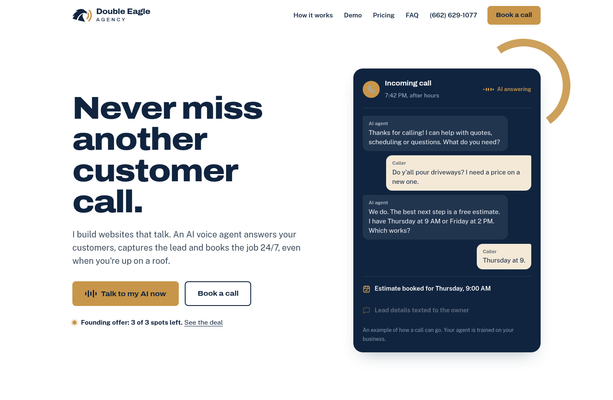

# Double Eagle Agency

Double Eagle builds AI receptionist websites for local contractors. The website answers the phone, takes the lead, and books the job when the owner is on a roof and cannot pick up.

This repository is the agency's own site: the sales page, a live voice demo, a missed-call calculator, pricing, and the privacy and terms pages. It is static HTML, CSS, and JavaScript.



## Run it locally

From the repository root:

```bash
python3 -m http.server 8080
```

Open http://127.0.0.1:8080.

`index.html` is the home page. `privacy.html` and `terms.html` are the legal pages. Phone, email, founding spots, and the sample contractor link come from `assets/js/config.js`. Refresh the page after you edit that file.

## Deploy

Netlify publishes this folder. `netlify.toml` holds the settings. Before the files go live, Netlify runs:

```bash
node scripts/apply-site-url.mjs
```

That command reads `siteUrl` from `assets/js/config.js` and writes the canonical URL, the social image URLs, `robots.txt`, and `sitemap.xml`.

1. Push this repository to GitHub.
2. In Netlify, create a site from the repository. The build command and publish directory already come from `netlify.toml`.
3. When the real domain is ready, set `siteUrl`, run the script, commit the updated files, and add the domain in Netlify.

Any other static host can serve the same folder. Run the script, upload the files, and point the host at the folder.

## Production domain

This repository has no production domain yet. `siteUrl` in `assets/js/config.js` is the only place to put it, and it is empty on purpose:

```js
// TODO: this repository does not include the real domain. Leave this empty
// until you have it. Example: "https://example.com"
siteUrl: "",
```

While `siteUrl` is empty, the page head, `robots.txt`, and `sitemap.xml` keep a TODO in place of the absolute URLs. After you set it, run:

```bash
node scripts/apply-site-url.mjs
```

Commit `assets/js/config.js` with the HTML, `robots.txt`, and `sitemap.xml`. The GitHub Action fails if those files drift apart.

## Checks

[`.github/workflows/ci.yml`](.github/workflows/ci.yml) validates the HTML and checks links on every push and pull request.

Java 21 and a network connection are required to run the same checks locally:

```bash
bash scripts/check.sh
```

The demo section still links to a sample contractor site that Netlify reported as “Site not found” on October 10, 2026. That address is listed in `scripts/link-exceptions.txt`, so the link check skips it until the sample site is deployed again.

## Where to edit business details

| What | Where |
|---|---|
| Founding spots, email, phone, sample site, backup booking link | `assets/js/config.js` |
| Production domain | `siteUrl` in `assets/js/config.js`, then `node scripts/apply-site-url.mjs` |
| Voice agent embed | Bottom of `index.html`, at `GOHIGHLEVEL VOICE AGENT EMBED` |
| Booking calendar embed | `index.html`, at `GOHIGHLEVEL BOOKING CALENDAR EMBED` |

The contact email is still the placeholder `email@yourdomain.com`. Change it in `assets/js/config.js`. The pages fill the address in from there.
